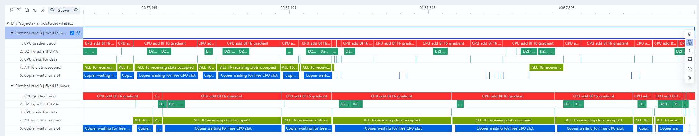

# Insight梯度搬运与CPU累加：槽全满的实测证据

固定16槽运行中既有槽全满，也有micro之间全空。全空结论只针对此前15处长断粮，不能推广到整步。此次只读复用已有数据，没有新占用NPU。

| 采样步累计（秒） | 0号 | 3号 |
|---|---:|---:|
| 原生梯度DMA活动 | 23.80 | 24.61 |
| CPU BF16梯度累加（不含CPUAdam） | 54.58 | 48.78 |
| 两者重叠 | 23.41 | 23.58 |
| 16槽全部占用 | 38.66 | 33.67 |
| 复制线程取空槽调用跨度 | 31.63 | 29.19 |

这些时间彼此重叠，不能相加。取空槽调用含短开销，过滤单次≤1ms后累计31.44/29.03秒。全占用区间根据每个槽的预留到CPU加法结束重建，边界有少量host记账开销；占用包括正在复制、数据就绪或CPU处理，不表示所有数据都到达。

但有直接已到达实例：3号步骤38.869883–38.912358秒中点，15槽数据已完成传输、等待CPU累加，另1槽正在累加。0号20.950476–20.978339秒同样15就绪+1处理。CPU消费跟不上会使复制线程等槽归还；之后micro交界梯度供应中断又会把队列消耗至全空，两者并不矛盾。

16槽各预留128MiB，但每个参数尾块也单独占槽；上述3号有效载荷约689MiB、0号731MiB，小于预留2GiB。槽数用满不等于有效字节填满。尚未通过新实验验证打包的整体收益，16槽及默认训练配置未改。

## 实际Insight视图与来源

从上到下：CPU加法、原生D2H、CPU等数据、16槽全占用、复制线程等空槽。截图下半为3号卡，显示槽满时CPU持续加法、复制线程等待。Insight将最早事件归零，因此横轴比步骤相对时间少约1.359秒。

`export_insight_overlap.py`已导出并成功导入编译版Insight。CPU自定义后台线程未被原生CPU profiler完整捕获，所以CPU行明确来自逐块实测host跨度；DMA为原生MEMCPY_INFO/TASK片段。槽占用行由实测生命周期重建，等待行为直接记录的queue.get调用。未捏造时序，未改原始DB/trace。host按hook/profiler标记对齐，MAD约15–16微秒，重叠统计是近似值。

这是派生诊断视图，不是全模型完整trace。统计见[过滤证据](../../evidence/2026-10-28/d2h16-insight-overlap-slots.json)。本轮不训练、不改数学与默认入口。
