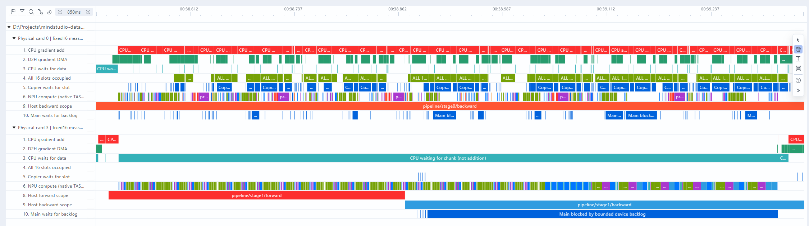

# 截图CPU断粮窗口：NPU是否连续计算

结论仅限用户截图横轴38.570秒所处的3号CPU等待。3号NPU基本连续计算，0号NPU明显间歇；不能把两卡一起概括成连续反向，也不能将CPU空等全部归因于卡间通信。本轮只读复用既有采样，未启动新训练。

截图时间按派生trace最早事件归零。对应步骤39.886571–40.677152秒，CPU等待790.58毫秒，下一块是model.norm.weight、10KiB。开始时16槽全空、待卸载梯度字节0。原生DMA约2.9微秒，CPU取到通知之前的尾部约0.43毫秒。

| 该790.58毫秒窗口 | 0号 | 3号 |
|---|---:|---:|
| NPU计算任务时间区间并集 | 400.83ms | 789.01ms |
| 计算任务覆盖率 | 50.7% | 99.8% |
| 最长无计算任务空隙 | 37.74ms | 0.35ms |
| 重叠的通信大算子 | 0 | 0 |

覆盖率指有计算任务执行的时间比例，不是芯片算力利用率，也不是证明所有计算都在算参数梯度。

3号Host记录先有stage1/forward，再有stage1/backward；设备任务包含MatMul、GDN前向相关任务和LogSoftmax。NPU忙于计算不等于已连续产出可卸载参数梯度，不能认为CPU只该等待卡间传输。Host范围用于识别提交阶段，不能用它的边界精确切分设备前向/反向耗时。

0号同期Host处于stage0/backward，但原生NPU计算只有400.83毫秒。最长37.74毫秒空隙中35.49毫秒与主线程main/wait_device_backlog_budget重叠，次长20.93毫秒空隙中19.52毫秒重叠。该窗口主线程累计等待额度134.35毫秒，其中83.32毫秒落在无计算任务区间，证明部分停顿与有界梯度卸载队列背压重叠。不能把全部约389.76毫秒无计算任务时间均归因于它，剩余还需拆分复制和下发等活动。

代码条件为pending_bytes非零且新增梯度超过512MiB待卸载预算时等待；该源梯度预算与CPU16×128MiB接收槽是两个不同限制。复制完成才能释放源梯度预算。3号Host也有约420毫秒预算等待，但同期设备已有任务仍在执行，无计算空隙与之重叠仅约0.18毫秒，所以不能直接把Host等待当设备停顿。

`analyze_pipeline_window.py`保留黄金Compute CTE与原生TASK区间，按时间并集计算覆盖；通信直接查询COMMUNICATION_OP窗口。逐卡Host时钟按实测hook标记映射。证据：[窗口统计与SQL](../../evidence/2026-10-28/d2h16-npu-window.json)。已在Insight派生trace增加第6行NPU计算、第7行通信、第8/9行Host阶段、第10行主线程额度等待。原始trace/DB、16槽及训练默认配置均未改，仍无本次训练进程占卡。
